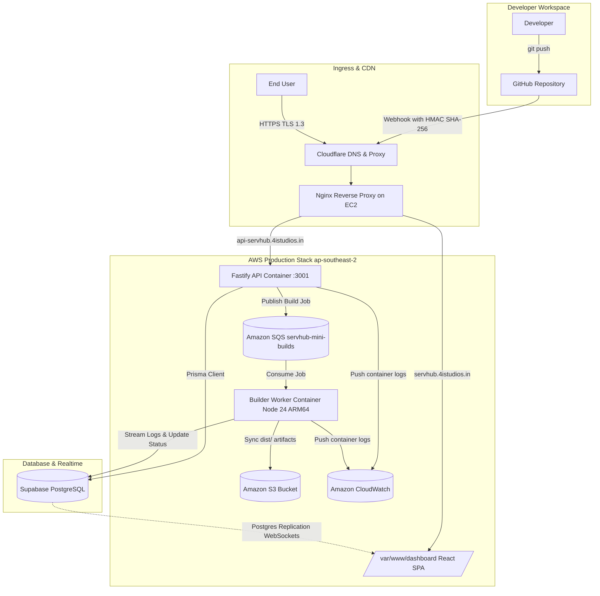

# ServHub Mini — Cloud Deployment Platform

> A lightweight, automated cloud deployment platform (Vercel alternative) powered by AWS Graviton2 ARM64, Supabase Realtime, and Cloudflare.

---

## 🌐 Live Deployments

| Component | Live URL | Status | Details |
|---|---|---|---|
| **Production Dashboard** | [https://servhub.4istudios.in](https://servhub.4istudios.in) | `Active` (HTTP 200) | React SPA frontend for project & deployment management |
| **Fastify API / Health** | [https://api-servhub.4istudios.in/health](https://api-servhub.4istudios.in/health) | `Active` (HTTP 200) | Backend REST API & GitHub Webhook ingress |
| **Edge Domain Base** | `https://*.4istudios.in` | `Active` | Custom SSL edge subdomains for user deployments |

---

## 📖 Project Overview

**ServHub Mini** is a developer platform designed to automatically build, package, and serve static sites and modern frontend frameworks (React, Vite, Next.js static, Vue, Astro) with zero manual server configuration.

### How It Works:
1. **GitHub Integration & OAuth**: Users log in using GitHub OAuth and connect their repositories with automatic webhook provisioning.
2. **Event Triggering**: A `git push` to GitHub (or a manual click in the dashboard) sends a webhook payload to the Fastify API.
3. **Job Queueing**: The API validates the HMAC SHA-256 signature, creates database records in Supabase, and publishes a build job to **Amazon SQS**.
4. **ARM64 Containerized Worker**: An isolated **builder worker** consumes the job from SQS, clones the repository, runs `npm ci --include=dev` and framework build steps (`npm run build`) in an ARM64 Node 24 runtime.
5. **Realtime Log Streaming**: Build output (`stdout`/`stderr`) is written in real time to Supabase Postgres, streaming live terminal logs to the user's browser via WebSocket replication.
6. **Edge Distribution**: Build artifacts (`dist/`) are synchronized to an **Amazon S3** bucket and served globally over **Cloudflare TLS 1.3**.

---

## 🏗️ Architecture & Infrastructure

### End-to-End Architecture Flow



---

## 🛠️ Infrastructure Stack Table

All cloud infrastructure is provisioned and managed via automated PowerShell deployment scripts (`deploy.ps1`).

| Category | Service / Tool | Resource Name / Configuration | Region / Host | Purpose |
|---|---|---|---|---|
| **Compute** | **Amazon EC2** | `servhub-prod` (`t4g.medium` — 2 vCPU, 4GB RAM, ARM64 Graviton2) | `ap-southeast-2` (Sydney) | Primary host server for Docker engine, Nginx proxy, and local storage |
| **OS & AMI** | **Canonical Ubuntu** | Ubuntu 26.04.1 LTS (`ami-0be7d1b5b9749d43a`) | `ap-southeast-2` | Modern, secure ARM64 operating system with 30GB gp3 EBS volume |
| **Networking** | **Amazon Elastic IP** | `servhub-eip` (`16.178.61.34`) | `ap-southeast-2` | Static, permanent public IPv4 address attached to EC2 |
| **Security & Firewall** | **EC2 Security Group** | `servhub-sg` (Ports: 22 SSH, 80 HTTP, 443 HTTPS) | `ap-southeast-2` | Ingress and egress firewall rules protecting host instances |
| **IAM & Roles** | **AWS IAM** | `servhub-ec2-role` / `servhub-ec2-profile` | Global | Instance profile granting EC2 zero-key access to SQS, S3, ECR & CloudWatch |
| **Message Queue** | **Amazon SQS** | `servhub-mini-builds` (SSE enabled, 600s visibility) | `ap-southeast-2` | Decouples API from build workers; handles asynchronous build scheduling |
| **Dead-Letter Queue** | **Amazon SQS DLQ** | `servhub-mini-builds-dlq` (Max receive: 3) | `ap-southeast-2` | Holds poisoned or repeatedly failing build messages for inspection |
| **Artifact Storage** | **Amazon S3** | `servhub-mini-deployments-681842289425` | `ap-southeast-2` | High-availability object storage for user-deployed web application bundles |
| **Container Registry** | **Amazon ECR** | `servhub-api`, `servhub-builder` | `ap-southeast-2` | Private Docker registries storing native ARM64 application container images |
| **Observability** | **Amazon CloudWatch** | `/servhub/api` & `/servhub/builder` log groups | `ap-southeast-2` | Aggregated Docker container logs via AWS native `awslogs` driver |
| **Monitoring** | **CloudWatch Alarms** | `servhub-builds-dlq-alarm` | `ap-southeast-2` | Alert triggers when messages land in the Dead-Letter Queue |
| **Database & Auth** | **Supabase** | Project `xkldqliccvgrfnckrlyw` | `aws-1-ap-south-1` | PostgreSQL persistence, Prisma ORM, and GitHub OAuth session handling |
| **Realtime Logs** | **Supabase Realtime** | Channels: `deployment-{id}`, `logs-{id}` | `aws-1-ap-south-1` | WebSocket streaming of live terminal build logs directly to client browser |
| **Edge & SSL** | **Cloudflare** | Full/Strict TLS 1.3 Proxy | Global Edge | Edge DDoS protection, automated SSL termination, and wildcard DNS routing |
| **Web Server** | **Nginx** | Reverse Proxy + Static Server | EC2 Host | Routes traffic between dashboard SPA and backend Fastify REST container |
| **Runtimes** | **Node.js & Docker** | Node.js 24 Alpine (`node:24-alpine`) | Docker on EC2 | Multi-architecture runtime executing API, worker, and Vite build commands |

---

## 📂 Monorepo Architecture

```
ServHub-mini/
├── apps/
│   ├── api/             # Fastify REST API, GitHub Webhook listener, Prisma schema
│   │   ├── prisma/      # Database schema (User, Project, Deployment, BuildLog)
│   │   ├── src/         # Routes: auth, projects, deployments, webhooks
│   │   └── Dockerfile   # Node 24 Alpine ARM64 multi-stage container
│   ├── builder/         # Build runner that consumes SQS & executes git/npm builds
│   │   ├── src/         # SQS message processor, git clone, npm build, S3 sync
│   │   └── Dockerfile   # Node 24 Alpine ARM64 container with Git & build tools
│   └── dashboard/       # React 19 + Vite frontend dashboard
│       ├── src/         # Pages (Dashboard, ProjectDetails, Deployment, Login)
│       └── dist/        # Optimized production SPA build served via Nginx
├── infra/               # IAM policies, trust policies, and provision scripts
└── deploy.ps1           # End-to-end PowerShell automated AWS deployment script
```

---

## 🚀 Local Development Setup

### 1. Prerequisites
- **Node.js 22+ or 24+**
- **Docker** (optional for local API, required for container builds)
- **AWS CLI v2** configured with necessary permissions
- **Supabase Account** with a configured project

### 2. Environment Configuration
Clone the repository and copy template files:
```bash
# Root deployment configuration
copy .env.deploy.template .env.deploy

# App-specific environment files
copy apps/api/.env.template apps/api/.env
copy apps/builder/.env.template apps/builder/.env
copy apps/dashboard/.env.template apps/dashboard/.env
```

### 3. Install & Generate
```bash
# Install workspace dependencies
npm install

# Generate Prisma database client
npm run prisma:generate
```

### 4. Running Locally
```bash
# Run Fastify API in development mode
npm run dev:api

# Run Frontend Dashboard in development mode
npm run dev:dashboard

# Run Builder Worker in development mode
npm run dev:builder
```

---

## 🚢 Deploying to Production (AWS)

The entire infrastructure and application stack can be deployed or updated in a single command using the automated deployment script:

```powershell
# Initial complete setup: provisions EC2, S3, SQS, IAM, Nginx, ECR, and builds apps
.\deploy.ps1

# Subsequent redeploys: updates images and dashboard without recreating infrastructure
.\deploy.ps1 -Resume
```

---

## 📜 License
This project is licensed under the MIT License.
