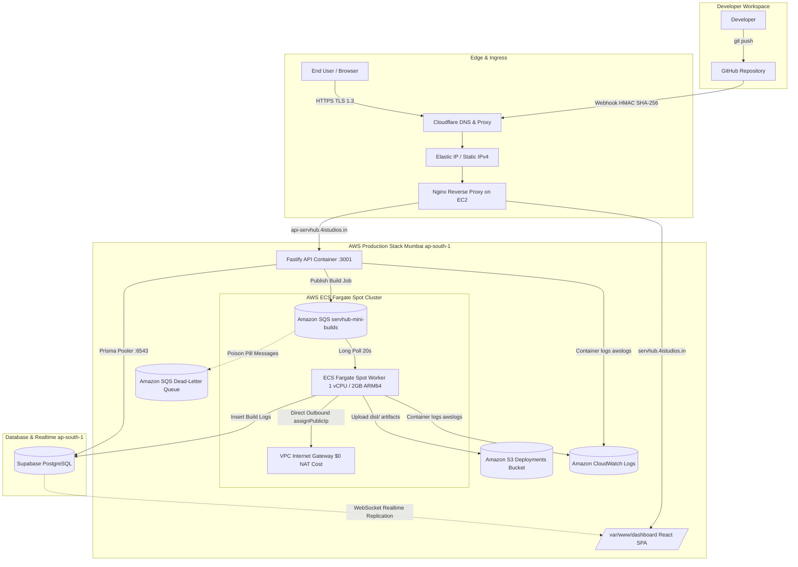

# ServHub Mini — Automated Cloud Deployment Platform

> A lightweight, cost-optimized cloud deployment platform (Vercel alternative) powered by **AWS Graviton2 ARM64**, **AWS ECS Fargate Spot**, **Amazon SQS**, **Supabase Realtime**, and **Cloudflare**.

---

## 🌐 Live Deployments

| Component | Live URL | Status | Details |
|---|---|---|---|
| **Production Dashboard** | [https://servhub.4istudios.in](https://servhub.4istudios.in) | `Active` (HTTP 200) | React SPA frontend for project, build & deployment management |
| **Fastify API / Health** | [https://api-servhub.4istudios.in/health](https://api-servhub.4istudios.in/health) | `Active` (HTTP 200) | Backend REST API & GitHub Webhook ingress |
| **Edge Domain Base** | `https://*.4istudios.in` | `Active` | Custom SSL edge subdomains for user deployments |
| **Permanent Elastic IP** | `Protected (AWS EIP)` | `Active` | AWS Mumbai (`ap-south-1`) static public IPv4 (Proxied via Cloudflare) |

---

## 📖 Project Overview

**ServHub Mini** is an automated developer platform designed to build, package, and serve modern web applications (React, Vite, Next.js static, Vue, Astro) with zero manual server configuration.

### How It Works:
1. **GitHub Integration & OAuth**: Developers sign in with GitHub OAuth and connect their repositories with automated webhook registration.
2. **Event Triggering**: A `git push` to a tracked branch (or manual redeploy trigger in the dashboard) delivers a webhook payload to the Fastify API.
3. **Asynchronous Job Queueing**: The API validates the HMAC SHA-256 signature, creates database records in Supabase, and publishes an isolated build job to **Amazon SQS**.
4. **AWS ECS Fargate Spot Build Worker**: An ephemeral **AWS ECS Fargate Spot** worker running an ARM64 Node 24 runtime claims the job, clones the repository, executes `npm ci` and the framework build command (`npm run build`).
5. **Realtime WebSocket Log Streaming**: Every line of `stdout` and `stderr` is streamed directly into Supabase Postgres, broadcasting live terminal logs to the user's dashboard via WebSockets.
6. **Artifact Storage & Edge Serving**: The generated production bundle (`dist/` or `build/`) is synchronized to **Amazon S3** and served securely with **Cloudflare TLS 1.3**.

---

## 🏗️ Architecture & Infrastructure Flow



---

## 🛠️ Complete Infrastructure Stack

All cloud infrastructure is provisioned and managed via automated, idempotent PowerShell scripts (`deploy.ps1` and `destroy.ps1`).

| Layer / Service | AWS Resource | Specification / Configuration | Region | Purpose |
|---|---|---|---|---|
| **Host Compute** | **Amazon EC2** | `servhub-prod` (`t4g.medium` — 2 vCPU, 4GB RAM, ARM64 Graviton2) | `ap-south-1` (Mumbai) | Hosts Fastify API container, Nginx reverse proxy, and dashboard assets |
| **Build Worker** | **AWS ECS Fargate Spot** | `servhub-mini-builder-service` (`FARGATE_SPOT`, 1 vCPU, 2GB RAM, ARM64) | `ap-south-1` (Mumbai) | Isolated, autoscaling serverless container that polls SQS and builds projects |
| **Worker Networking** | **VPC Public Subnets** | `assignPublicIp: ENABLED` via default VPC Internet Gateway | `ap-south-1` (Mumbai) | **Zero-Cost Optimization**: Outbound internet for npm/git with **$0 NAT Gateway costs** |
| **Elastic IP** | **Amazon EC2 EIP** | `servhub-eip` (`<ALLOCATED_ELASTIC_IP>`) | `ap-south-1` (Mumbai) | Permanent, static public IPv4 address ensuring Cloudflare DNS never breaks |
| **OS & AMI** | **Canonical Ubuntu** | Ubuntu 24.04 LTS ARM64 (`ami-060a59f869a11dca4`) | `ap-south-1` (Mumbai) | Secure ARM64 base operating system with 20GB gp3 EBS storage |
| **Firewall / SG** | **EC2 Security Group** | `servhub-sg` (Inbound: 22 SSH, 80 HTTP, 443 HTTPS; Outbound: 0.0.0.0/0) | `ap-south-1` (Mumbai) | Host network access control |
| **Task Roles** | **AWS IAM** | `servhub-mini-builder-task-role` & `ecsTaskExecutionRole` | Global | Temporary credentials for SQS polling, S3 uploads, and ECR image pulls |
| **Host Role** | **AWS IAM** | `servhub-ec2-role` / `servhub-ec2-profile` | Global | EC2 instance profile granting zero-static-key access to CloudWatch, ECR, and S3 |
| **Message Queue** | **Amazon SQS** | `servhub-mini-builds` (Standard, SSE enabled, 600s visibility) | `ap-south-1` (Mumbai) | Asynchronous build job pipeline decoupling API from workers |
| **Dead-Letter Queue**| **Amazon SQS DLQ** | `servhub-mini-builds-dlq` (Max receive count: 3) | `ap-south-1` (Mumbai) | Dead-letter storage for unhandled or repeatedly failing build payloads |
| **Artifact Storage** | **Amazon S3** | `servhub-mini-deployments-${AWS_ACCOUNT}` | `ap-south-1` (Mumbai) | High-availability object store for compiled project release bundles |
| **Container Registry**| **Amazon ECR** | `servhub-api`, `servhub-builder` | `ap-south-1` (Mumbai) | Private OCI registry storing native ARM64 container images |
| **Observability** | **CloudWatch Logs** | `/servhub/api` & `/ecs/servhub-mini-builder` | `ap-south-1` (Mumbai) | Structured log streams with 14-day automated retention policy |
| **Database & Auth** | **Supabase Postgres** | Dedicated Postgres instance | `aws-1-ap-south-1` (Mumbai) | Low-latency (<2ms) co-located database for metadata, users, and deployments |
| **Realtime Logs** | **Supabase Realtime** | WebSocket channels: `deployment-{id}` | `aws-1-ap-south-1` (Mumbai) | Real-time terminal streaming of build logs to client dashboard |
| **Edge & CDN** | **Cloudflare** | Full/Strict TLS 1.3 Proxy | Global Edge | Edge DDoS mitigation, global caching, and wildcard SSL termination |

---

## ⚡ Deployment & Teardown Commands

### 1. Automated AWS Deployment (`deploy.ps1`)

The deployment script is fully automated and self-contained. It detects your AWS account identity, provisions all infrastructure, configures security groups, builds ARM64 Docker images natively, registers ECS Fargate tasks, compiles the frontend, and configures Nginx.

```powershell
# Step 1: Copy and populate your configuration
Copy-Item .env.deploy.template .env.deploy
# (Edit .env.deploy with your Supabase credentials, GitHub OAuth keys, and domain)

# Step 2: Run the full infrastructure deployment
.\deploy.ps1

# Step 3: Fast redeploy (updates containers & dashboard without recreating AWS resources)
.\deploy.ps1 -Resume
```

#### What `deploy.ps1` executes automatically:
1. Validates AWS CLI credentials and caller identity.
2. Creates EC2 IAM roles, instance profiles, and ECS execution/task roles with least privilege.
3. Provisions the S3 deployment bucket with versioning and public-access block.
4. Creates the SQS build queue and Dead-Letter Queue (DLQ) with redrive policy.
5. Provisions CloudWatch log groups with 14-day retention.
6. Creates the ECS Cluster with `FARGATE` and `FARGATE_SPOT` capacity providers.
7. Generates an SSH key pair (`servhub-key`) and security group (`servhub-sg`).
8. Launches a `t4g.medium` ARM64 Graviton2 instance and associates a permanent Elastic IP.
9. Connects via SSH, installs Docker, Nginx, and AWS CLI v2.
10. Packages application sources, builds ARM64 containers directly on EC2, and pushes to ECR.
11. Starts the `servhub-api` container on port 3001 with native CloudWatch logging.
12. Registers the `servhub-mini-builder` task definition and deploys the **ECS Fargate Spot service**.
13. Compiles the React dashboard and uploads static assets to `/var/www/dashboard`.
14. Generates SSL certificates and reloads Nginx reverse proxy.
15. Prints the Elastic IP and Cloudflare DNS instructions.

---

### 2. Idempotent Infrastructure Teardown (`destroy.ps1`)

When you want to remove all resources to avoid any ongoing AWS costs, run `destroy.ps1`. The script is **100% idempotent** and can be run safely multiple times.

```powershell
# Interactive teardown (prompts for confirmation before deleting):
.\destroy.ps1

# Unattended / CI teardown (skips confirmation prompt):
.\destroy.ps1 -Force

# Clean up a specific region (default: ap-south-1):
.\destroy.ps1 -Region ap-south-1 -Force
```

#### What `destroy.ps1` cleans up:
- Scales down and deletes the **ECS Fargate Spot Service** and deregisters all task definitions.
- Deletes the **ECS Cluster** (`servhub-mini-cluster`).
- Deletes **CloudWatch Log Groups** (`/servhub/api`, `/ecs/servhub-mini-builder`) and alarms.
- Terminates the **EC2 Instance** (`servhub-prod`) and releases the **Elastic IP** (`servhub-eip`).
- Deletes the **Security Group** (`servhub-sg`) and **EC2 Key Pair** (`servhub-key`).
- Deletes the **SQS Queues** (`servhub-mini-builds`, `servhub-mini-builds-dlq`).
- Empties all versioned objects and deletes the **S3 Bucket** (`servhub-mini-deployments-*`).
- Force-deletes the **ECR Repositories** (`servhub-api`, `servhub-builder`).
- Detaches policies and deletes all **IAM Roles and Instance Profiles**.

---

### 3. Cloudflare DNS Mapping (1-Time Setup)

Once the deployment finishes and gives you the Elastic IP, add these two A records in your Cloudflare DNS dashboard:

| Type | Name | Content / IPv4 | Proxy Status |
|---|---|---|---|
| **A** | `servhub` | `<YOUR_ELASTIC_IP>` | **Proxied (Orange Cloud)** |
| **A** | `api-servhub` | `<YOUR_ELASTIC_IP>` | **Proxied (Orange Cloud)** |

*Because an Elastic IP is allocated, you never have to reconfigure DNS even after redeployments or server reboots.*

---

## 📂 Repository Structure

```
ServHub-mini/
├── apps/
│   ├── api/             # Fastify REST API, GitHub Webhook listener, Prisma schema
│   │   ├── prisma/      # Database schema (User, Project, Deployment, BuildLog)
│   │   ├── src/         # Routes: auth, projects, deployments, webhooks
│   │   └── Dockerfile   # Node 24 Alpine ARM64 multi-stage container
│   ├── builder/         # ECS Fargate Spot build worker
│   │   ├── src/         # SQS message processor, git clone, npm build, S3 sync
│   │   └── Dockerfile   # Node 24 Alpine ARM64 container with Git & build tools
│   └── dashboard/       # React 19 + Vite frontend dashboard
│       ├── src/         # Pages (Dashboard, ProjectDetails, Deployment, Login)
│       └── dist/        # Optimized production SPA build served via Nginx
├── infra/               # Infrastructure JSON definitions & database migration helpers
│   ├── builder-task-policy.json
│   ├── cloudwatch-dashboard.json
│   ├── ec2-role-policy.json
│   ├── ecs-network-config.json
│   ├── fix-uuid-defaults.sql
│   └── nginx-servhub.conf
├── .env.deploy.template # Deployment credentials template
├── deploy.ps1           # End-to-end automated deployment script
├── destroy.ps1          # Idempotent infrastructure destruction script
├── docker-compose.yml   # Local development services
└── package.json         # Workspace root scripts
```

---

## 💻 Local Development Setup

### 1. Prerequisites
- **Node.js 22+ or 24+**
- **Docker**
- **AWS CLI v2** configured with `aws configure`
- **Supabase Account** with a PostgreSQL database project

### 2. Environment Setup
```bash
# Clone the repository
git clone https://github.com/your-username/ServHub-mini.git
cd ServHub-mini

# Configure environment variables
copy .env.deploy.template .env.deploy
copy apps/api/.env.template apps/api/.env
copy apps/builder/.env.template apps/builder/.env
copy apps/dashboard/.env.template apps/dashboard/.env
```

### 3. Install & Initialize
```bash
# Install root and workspace dependencies
npm install

# Generate Prisma client
npm run prisma:generate
```

### 4. Run Development Servers
```bash
# Run Fastify API server
npm run dev:api

# Run Vite Dashboard frontend
npm run dev:dashboard

# Run Builder Worker
npm run dev:builder
```
